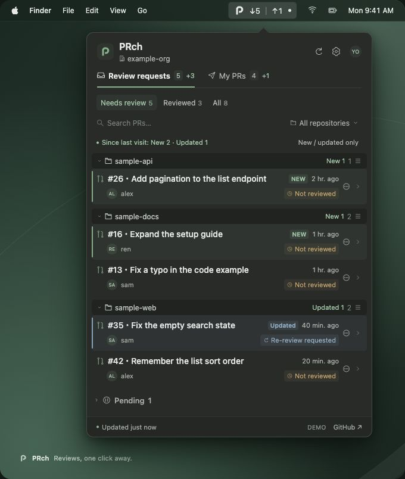

# PRch

A small, native macOS menu bar app for GitHub pull request reviews. See what needs your review and what your own open PRs are waiting for, grouped by repository.

Built with SwiftUI and Foundation. No Swift package dependencies, hosted backend, analytics, or embedded credentials.

[日本語](README.ja.md)



*UI illustration with fictional data.*

## Features

- Incoming: direct review requests and open PRs you have reviewed, with needs-review / reviewed filters.
- Outgoing: all your open PRs, including each reviewer's state and an unrequested filter for PRs without a human review or an active review request.
- Defer incoming review requests or your own PRs locally with **Move to Pending** in the row menu or PR details. Pending PRs appear in a collapsed, repository-grouped section and are excluded from tab, status-filter, and menu bar counts. Search and repository filtering still apply. Restore them manually; refreshes and restarts retain the choice per GitHub account, without changing GitHub review state. Closed/merged PRs leave the list on refresh.
- New review requests show **NEW**; creating your own PR stays quiet. Review-state changes, including reviews on your own PRs, show **Updated**, with subtle row highlights and counts on tabs/repository groups. Filter for new/updated PRs only. The menu bar adds an unseen-activity dot (or a configurable +count). Highlights remain while open; closing or minimizing the panel marks all PRs in the tabs you opened as seen, including filtered, collapsed, and scrolled-out rows. Unopened tabs stay unread. Pending PRs stay quiet.
- Readable 14-point PR titles, 11–12-point supporting text, 60-point rows, repository grouping, search, and temporary repository filtering. Press **⌘F** while the PR list is open to focus the search field.
- Click a PR row to copy `repo_name#pr_number` to the clipboard; double-click to open the PR on GitHub. The arrow on the right opens reviewer and check details.
- Click a repository heading to collapse or expand its PRs. Drag it onto another heading to reorder repositories. Both choices are shared across tabs and Pending, and persist across refreshes and restarts; collapsed PRs still contribute to counts.
- Monitor multiple organizations together, with per-repository checkboxes and an organization-level select-all checkbox.
- Private repositories supported through the current GitHub CLI account's existing access.
- Automatic refresh (1, 2, or 5 minutes), manual refresh, and backoff after errors.
- GitHub links, reviewer details, draft indicators, CI checks, and conflict indicators.
- The menu bar defaults to separate counts: **↓ incoming reviews needing your response / ↑ changes requested on your own PRs**. Settings also offer review count + changes dot, total actions, and dot only, with an immediate preview. The choice persists across restarts. Zero counts are hidden; counts over 99 display as 99+. Hover for exact counts and the active scope.
- Your GitHub account avatar in the panel header, with initials as a loading/offline fallback.
- Japanese and English UI with a persistent language setting (System default / 日本語 / English). Changes apply immediately, including statuses, errors, relative times, and menu bar tooltips. Unsupported system languages fall back to English.
- Native light/dark appearance. No Dock icon.

## Requirements

- macOS 14 or newer.
- Xcode 16 or newer / a Swift 6 toolchain to build.
- [GitHub CLI](https://cli.github.com/) installed at `/opt/homebrew/bin/gh`, `/usr/local/bin/gh`, or `/opt/local/bin/gh`.
- A GitHub.com account authenticated in `gh`, with access to the organization you want to monitor.

## Build and run

```sh
brew install gh
gh auth login --hostname github.com
swift test
bash scripts/build-app.sh
open dist/PRch.app
```

On first launch, enter your organization in the setup window and save. After setup, close the window and use the P icon in the menu bar. Reopening the app from Finder, or choosing "ウインドウで開く", also opens the same panel in a regular window. The organization is intentionally blank on first launch. Private repositories require that your GitHub account and the credential used by `gh` can access them. If the organization enforces SSO or token approval, complete the relevant authorization in GitHub.

The app only makes read queries. It does not request extra scopes, create tokens, submit reviews, or merge PRs. Some pre-existing `gh` credentials may have broader permissions; PRch does not change those permissions. Authentication is managed by `gh`, including any `GH_TOKEN` / `GITHUB_TOKEN` environment overrides supported by the CLI.

`build-app.sh` creates an ad-hoc signed local app bundle. Public binary distribution still requires a release/signing/notarization workflow. This repository does not contain a signing identity or certificate.

## Repository scope

Add each organization in Settings. Every organization has a **select-all checkbox** and individual repository checkboxes. A partially selected organization shows a mixed-state checkbox; clicking it selects all repositories in that organization. Search narrows the visible rows, while select-all always applies to the entire organization.

New organizations start with all accessible, non-archived repositories selected. Select-all also includes future repositories; individual unchecks become exceptions. After clearing all, only explicitly checked repositories are monitored, including when new repositories appear. Existing single-organization and Include/Exclude preferences migrate without changing their monitored scope.

Scope is applied to both tabs and menu bar counts, aggregated across all configured organizations. With multiple organizations, repository groups and filters use `organization/repository` to distinguish identical names. Preferences are stored locally (`dev.prch.app`), not in the checkout. The list's repository picker is a separate, temporary display filter.

## Review semantics

- Incoming searches use `user-review-requested:<viewer>` plus `reviewed-by:<viewer>`, always restricted to open PRs in each configured organization. Reviewed PRs remain available until closed or merged. Self-initiated reviews also appear in the reviewed filter. Team-only requests are not added to the incoming list in this version.
- An active request following a submitted review is shown as a re-review request.
- A comment does not supersede an earlier approval or changes request. Dismissed opinions are not shown as approvals.
- Outgoing prioritizes changes requested, then outstanding reviewers, then GitHub's required-review decision. Requesting re-review from everyone who requested changes moves the PR back to Waiting, even if GitHub's overall decision still says changes requested. Changes from anyone who has not been asked to review again keep the PR in Changes.
- By default, one person's approval does not hide another person's pending review. Enable **Mark my PRs approved after one approval** in Settings to show Approved after any current human approval, even if other reviews are pending or GitHub still requires more reviews. Changes requested takes priority; bot approvals, dismissed approvals, and approvals awaiting re-review do not qualify. The setting applies immediately to badges, filters, and sorting, and persists across restarts. Individual reviewer states and incoming requests stay unchanged. This only changes PRch's display; it does not change GitHub's merge requirements or create activity notifications. An approval is not a claim that a PR is mergeable.
- Reviewers may include people, bots, and teams. Bots alone do not produce an approval status. Team membership is not expanded.
- PR searches, review histories, review requests, and repository lists are paginated. GitHub's search cap is 1,000 results per query; a warning appears if reached. Search indexing can lag recent changes.
- If any organization fails to refresh, the last complete snapshot is retained with a visible stale-data message; partial totals are never published. Closing or merging a PR removes it on the next successful refresh.

Activity starts with a quiet baseline on the first successful fetch for each account. Adding a monitoring scope baselines newly discovered PRs instead of flagging old work as new. Subsequent successful fetches compare review state, including human reviewer states on your own PRs; title, timestamp, CI-only and bot-only changes do not trigger activity. Changes between polls that return to the same state cannot be detected. Activity is per PR, so replacing a closed PR with a new one is detected even when totals are unchanged. Unseen markers survive restarts, and closing a panel only acknowledges the revision actually displayed.

## Development

```sh
swift test                         # Synthetic data only; no GitHub credentials needed
bash scripts/build-app.sh debug
open dist/PRch.app --args --demo   # Synthetic data; no GitHub requests
open dist/PRch.app --args --demo --demo-activity --window # Synthetic new/updated PRs
```

Quit any existing PRch process before launching another mode. Demo preferences are isolated in `dev.prch.demo`. Use demo mode for screenshots and public issues: live private PR titles, repository names, and account details must not be included in public artifacts.

An optional integration test uses your existing CLI login and prints counts only:

```sh
PRCH_LIVE_ORG=your-organization swift test --filter liveGitHubSmokeTest
```

The integration test does not store PR payloads. Normal tests and CI skip it.

## Layout

```text
Sources/ReviewCore/     GitHub transport, pagination, scope, and review classification
Sources/PRch/           SwiftUI menu bar UI, settings, and in-memory app state
Tests/ReviewCoreTests/  Synthetic unit/integration tests
Resources/Info.plist    Local app bundle metadata
Resources/Brand/        PRch P monogram and Forest Green app icon artwork
Resources/AppIcon.icns  App icon at standard and Retina sizes
scripts/build-app.sh    Reproducible app bundle creation
```

The menu bar and panel header use a template P monogram that follows the system appearance. Finder uses the Forest Green app icon. To regenerate the PNG and `.icns` from `Resources/Brand/AppIcon.svg`, run `bash scripts/generate-app-icon.sh`; this uses only Swift/AppKit and macOS's built-in image tools. Keep the monogram in `Sources/PRch/BrandIcon.swift` and `Resources/Brand/Mark.svg` in sync when editing its shape.

The public account avatar is fetched from GitHub’s avatar CDN using the URL returned by the [GitHub User API](https://docs.github.com/en/graphql/reference/users#user). Avatar requests do not include GitHub credentials. No PR payloads are cached on disk. Only organization/repository selections, display preferences, Pending PR IDs, and hashed review-state fingerprints/unseen markers keyed by account persist locally. Raw GitHub errors are not logged or surfaced because they can contain private names. CI runs without GitHub credentials. Dependencies and build outputs stay outside tracked source.

Current scope: GitHub.com, multiple organizations, Japanese/English UI, manual app launch. Enterprise hosts, native OAuth, notifications, and launch-at-login are not implemented yet.

## License

MIT. This app is independent of other projects named Prch, including the Swift library published by brightdigit. GitHub is a trademark of its respective owner.
